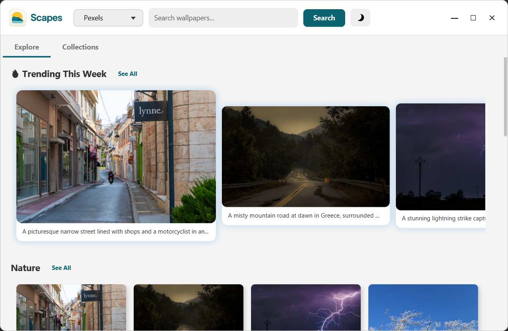
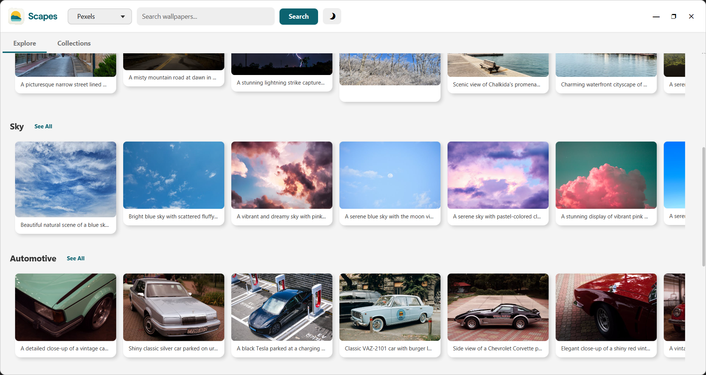
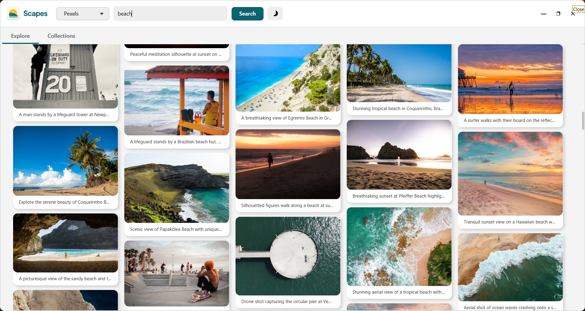
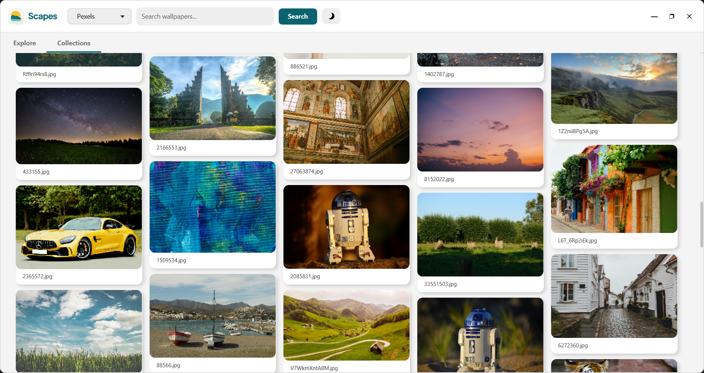

  

  

<h1 align="center">Scapes</h1>

A desktop wallpaper browser.

---

## Changelog

### v1.1.1
- Added multithreading for front-end and download processes
- Added snackbar notification
- Minor fixes

---

## Main Features

### Main Page

  

---

### Wallpaper Search

  

---

### Wallpaper Collection

  

---

## Contributors

- **Bintang Stevan**
- **Farrel Rozzaq**
- **Ariwata Alfajri**

---

  
  &nbsp;
  
  &nbsp;
  
  &nbsp;
  
  &nbsp;
  

  <b>JavaFX • Python (Flask) • PHP • MySQL</b>

